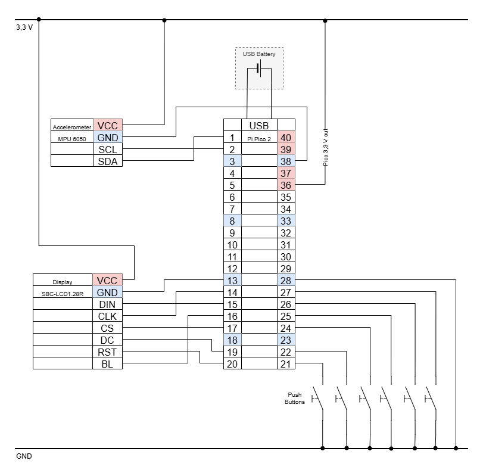
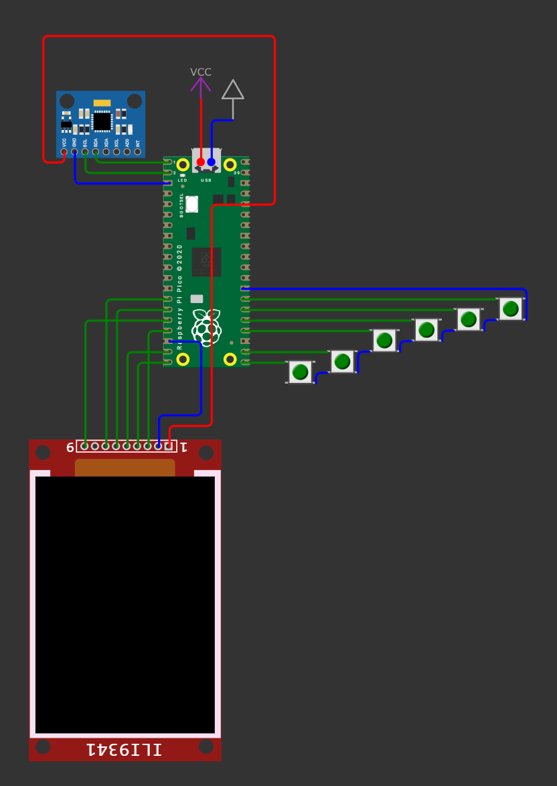
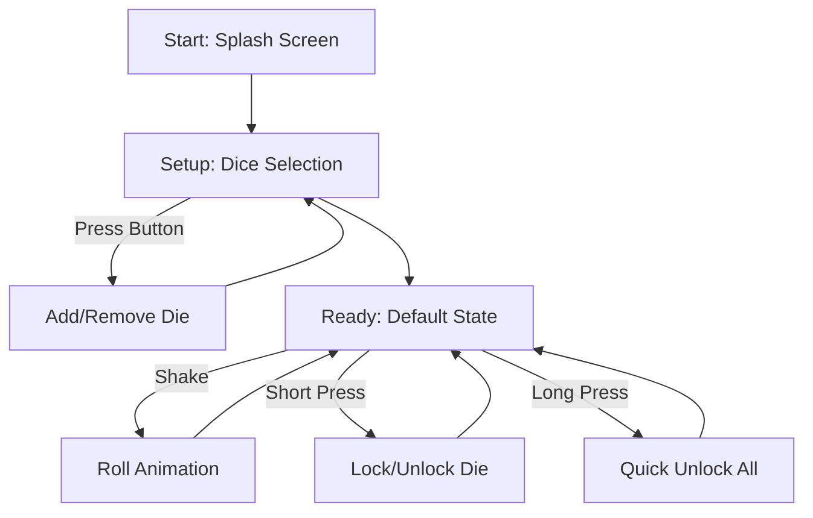

# **Kniffomat 🎲**
A compact, Raspberry Pi Pico-powered replacement for traditional dice, specifically optimized for games like Kniffel (Yahtzee).

---

## **Table of Contents**
1. [Features and Controls](#1-features-and-controls)
2. [Hardware Requirements](#2-hardware-requirements)
3. [Wiring](#3-wiring)
4. [Software Logic](#4-software-logic)
5. [Installation and Flashing](#5-installation-and-flashing)
   5.1 [Getting the Firmware](#51-getting-the-firmware)
    * [Option 1: Download from GitLab](#option-1-download-from-gitlab-recommended)
    * [Option 2: Build Natively](#option-2-build-natively)

   5.2 [Installing the Firmware](#52-installing-the-firmware)

---

# 1. Features and Controls
The Kniffomat replaces physical dice with a travel-friendly device. Instead of throwing dice, you shake the cup to roll and use physical buttons to lock your results.

**Locking**: After a roll, press the button corresponding to a die to "lock" it. Locked dice will not change during the next roll  
**Quick Unlock**: Perform a long press on any of the 6 buttons to instantly unlock all dice.  
**Session Setup**: When the device starts, all dice icons blink. During this phase, you can toggle each die "On" or "Off" for the current  session by pressing its button.  
**Rolling the Dice**: Trigger a roll by shaking the device.  

---

# 2. Hardware Requirements
| Component | Quantity |Notes |
| :--- | :---: | :--- |
| **Raspberry Pi Pico 2 H** | 1 | RP235x, pre-soldered headers, Micro-USB |
| **LCD Display (DEBO LCD 1.28)** | 1 | Round LCD, 240x240 Pixels (GC9A01 driver) |
| **Accelerometer (MPU6050)** | 1 | 3-axis motion sensor |
| **Push-Buttons** | 6 |Standard 6x6mm tactile switches (e.g. OMR B3F-1002)|
| **Breadboard** | 1 | For solderless prototyping |
| **Jumper Wires (M/M)** | 1 Set | To connect all components on the breadboard |
| **USB Cable** | 1 | Micro USB for power and data |
| **Powerbank** | 1 | Any standard 5V USB power supply |

---

# 3. Wiring
### **Display (SPI)**

<details>
<summary><b>Click to expand Wiring Diagram</b></summary>

</details>
<details>
<summary><b>Click to expand Component Diagram</b></summary>

</details>
<details>
<summary><b>Click to expand Pin Table</b></summary>

| LCD Pin | Pico GPIO | Physical Pin | Function |
| :--- | :--- | :--- | :--- |
| **DIN (MOSI)** | **GP11** | Pin 15 | SPI TX |
| **CLK** | **GP10** | Pin 14 | SPI Clock |
| **CS** | **GP13** | Pin 17 | Chip Select |
| **DC** | **GP14** | Pin 19 | Data/Command |
| **RST** | **GP15** | Pin 20 | Reset |
| **MISO** | **GP12** | Pin 16 | (Unused by LCD) |

### **Accelerometer (I2C)**


| MPU Pin | Pico GPIO | Physical Pin | Function |
| :--- | :--- | :--- | :--- |
| **SDA** | **GP0** | Pin 1 | I2C Data |
| **SCL** | **GP1** | Pin 2 | I2C Clock |

### **Lock Buttons**
Connect one side to the GPIO and the other to **GND**.

| Button | Pico GPIO | Physical Pin |
| :--- | :--- | :--- |
| **Button 1** | **GP16** | Pin 21 |
| **Button 2** | **GP17** | Pin 22 |
| **Button 3** | **GP18** | Pin 24 |
| **Button 4** | **GP19** | Pin 25 |
| **Button 5** | **GP20** | Pin 26 |
| **Button 6** | **GP21** | Pin 27 |

</details>
---

# 4. Software Logic
<details>
<summary><b>Click to expand</b></summary>
The Kniffomat is structured as a state machine to handle hardware interrupts and UI transitions efficiently.



#### **1. Boot & Setup**
* **Initialization**: On power-up, the splash screen is displayed while the system calibrates the **MPU6050** accelerometer and mounts the **GC9A01** display driver.
* **Dice Configuration**: The system enters a selection state where dice icons blink. Physical buttons toggle the number of active dice (1–6). This configuration persists for the remainder of the session.

#### **2. The "Roll" Mechanism**
* **Shake Detection**: The accelerometer is polled for G-force spikes. When a specific threshold is crossed, the system state transitions from `IDLE` to `ROLL`.
* **Pseudo-Randomness**: Results are calculated using a Linear Congruential Generator, seeded via the system timer at the exact moment of the first shake.
* **Visual Feedback**: A "glitch" frame sequence plays on the LCD to provide an aesthetic "rolling" effect during the calculation.

#### **3. Gameplay & Input**
* **Dice Locking**: In the result state, buttons 1–6 function as toggles. Locking a die flags it to be skipped by the randomizer in the next roll.
* **Lock UI**: Locked dice are redrawn with a color-inverted background for high-contrast visibility.
* **Global Clear**: A long-press (>600ms) on any of the buttons resets all lock flags to `false`, allowing for a fresh throw.

</details>

---

# 5. Installation and Flashing

---

## 5.1 Getting the Firmware

You can get the firmware for your Pico in one of two ways:
1. **[GitLab Pipeline](#option-1-download-from-gitlab-recommended)**: Let GitLab build it for you and download the result.
2. **[Build Natively](#option-2-build-natively)**: Build it on your own machine (best for development).

### **Option 1: Download from GitLab (Recommended)**

You do not need to install any software to get the latest firmware. You can simply fork this repository and let the GitLab CI/CD pipeline build it for you.

1. **Fork the Project**
   * Click the **Fork** button in the top right of the GitLab repository page.
   * Select your personal namespace.

2. **Run the Pipeline**
   * Go to **Build > Pipelines** in the left sidebar of your forked repository.
   * If a pipeline isn't running already, click **Run pipeline** in the top right.
   * Select the `main` branch and click **Run pipeline**.

3. **Download the Artifacts**
   * Once the pipeline finishes (Green Checkmark ✅), click the **Download** icon on the right side of the pipeline row.
   * Select **Build Artifacts** (or the specific job name, e.g., `build_firmware`).
   * Unzip the download and locate the `.uf2` file.

### **Option 2: Build Natively**

If you want to modify the code or develop locally, follow these steps.

#### **1. Install Build Dependencies**
You need CMake, the ARM GCC compiler, and standard build tools.

**Ubuntu / Debian / Raspberry Pi OS:**
```
sudo apt update
sudo apt install cmake gcc-arm-none-eabi libnewlib-arm-none-eabi build-essential
```

**Fedora:**
```
sudo dnf install cmake arm-none-eabi-gcc-cs arm-none-eabi-newlib make
```

***macOS:***
```
brew install cmake arm-none-eabi-gcc
```

#### **2. Clone the Repository**
```
git clone https://gitlab.mi.hdm-stuttgart.de/embedded/ws25/kniffel.git
cd your-project
```

#### **3. Build the Firmware**
We use PICO_SDK_FETCH_FROM_GIT=ON, so the build system will automatically download the Pico SDK for you during the first configuration.
```
mkdir -p build
cd build

# Configure the project (downloads SDK automatically)
cmake -DPICO_SDK_FETCH_FROM_GIT=ON ..

# Compile
make
```

---

## 5.2 Installing the Firmware
### **1. Enter Bootloader Mode**

1. Unplug the Pico
2. Hold **BOOTSEL**
3. Plug in USB
4. Release BOOTSEL
   A drive appears:

* **RP2350** → Pico 2

### **2. Deploy**

Drag your `.uf2` into the Pico’s USB storage device.

If the file is valid:

* The drive **disappears**
* The Pico **reboots automatically**

If it **stays mounted**, your UF2 is invalid (wrong board, corrupted build, etc.).

### **3. Run**
The Pico will automatically reboot and start the Kniffomat!
